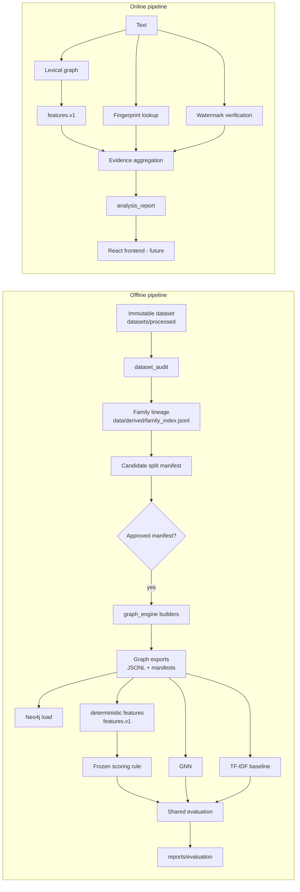

# MVGR-AI

Multi-view graph analysis of human, AI, paraphrased, and deeply paraphrased
text. MVGR-AI turns each document into a graph, extracts deterministic graph
features, and combines them with fingerprint and watermark evidence into a
single, honest evidence report. It never treats the absence of a watermark or
the absence of a model as proof of human authorship.

The dataset is the source of truth. Nothing here invents records, labels, or
paraphrase links, and no artifact may leak labels, source, task, family,
condition, or split into graph structure or model features.

---

## Repository layout

```text
MVGR-AI/
├── README.md
├── requirements.txt
├── .env.example
├── .gitignore
├── pyproject.toml                # additive packaging/CLI entry point
├── mvgr.py                       # additive CLI: audit, split, build, serve, ...
│
├── configs/
│   ├── dataset_config.yaml
│   ├── graph_config.yaml
│   ├── experiment_config.yaml
│   └── evaluation_config.yaml
│
├── data/
│   ├── raw/
│   ├── processed/                # byte-identical contract copy of the source
│   ├── derived/                  # family index, caches
│   └── manifests/                # candidate + approved split manifests
│
├── dataset_audit/
│   ├── inventory.py
│   ├── label_mapping.py
│   ├── lineage.py
│   └── leakage_audit.py
│
├── deterministic/
│   ├── feature_extractor.py
│   ├── clustering.py
│   ├── degree_distribution.py
│   ├── centrality.py
│   ├── graph_density.py
│   ├── shortest_path.py
│   ├── community.py
│   ├── connectivity.py
│   └── scoring.py
│
├── baseline/
│   └── tfidf_logistic.py
│
├── fingerprinting/
│   ├── sha256.py
│   ├── ngram.py
│   └── minhash.py
│
├── watermark/
│   └── verifier.py
│
├── graph_engine/
│   ├── graph_builder/
│   │   ├── lexical_graph.py
│   │   └── syntactic_graph.py
│   ├── neo4j/
│   │   ├── connection.py
│   │   ├── schema.py
│   │   ├── loader.py
│   │   └── queries.py
│   ├── graph_export/
│   │   └── export.py
│   └── gnn/
│       ├── dataset.py
│       ├── model.py
│       ├── train.py
│       └── predict.py
│
├── shared/
│   ├── contracts/
│   │   ├── graph_schema.json
│   │   └── prediction_schema.json
│   ├── preprocessing/
│   └── validation/
│
├── backend/
│   ├── main.py
│   ├── routes/
│   ├── services/
│   └── schemas/
│
├── frontend/                     # placeholder this phase (no UI code yet)
│   └── README.md
│
├── evaluation/
│   ├── metrics.py
│   ├── comparison.py
│   └── error_analysis.py
│
├── experiments/
│   ├── configs/
│   ├── predictions/
│   ├── checkpoints/
│   └── logs/
│
├── reports/
│   ├── dataset_audit/
│   ├── graph_audit/
│   ├── evaluation/
│   └── final/
│
└── tests/
    ├── test_dataset.py
    ├── test_graph.py
    ├── test_deterministic.py
    └── test_integration.py
```

Two artifacts are intentionally outside this tree: `datasets/` (the immutable
upstream download) and `dataset_preparation.py` + `scripts/` (the legacy
generator that produced it). The audit verifies that `data/processed/` is a
byte-identical copy of `datasets/processed/` and fails closed if it is not.

---

## Two pipelines



The offline pipeline is the only path allowed to train or evaluate. The online
pipeline reuses the *same* graph builder, tokenizer, and feature registry as
offline so that a score means the same thing in both.

---

## Quickstart

```powershell
py -3.12 -m venv .venv
.\.venv\Scripts\Activate.ps1
python -m pip install --upgrade pip
pip install -r requirements.txt
pip install -e ".[graph,baseline,dev]"      # networkx + scikit-learn + pytest
```

Run the audit (fails closed until the split manifest is approved):

```powershell
python mvgr.py audit
python mvgr.py lineage
```

Build candidate split manifests:

```powershell
python mvgr.py split-manifest --mode regenerate --scope pooled
python mvgr.py split-manifest --mode existing   --scope pooled
python mvgr.py split-manifest --mode regenerate --scope source_scoped --sources PADBen
```

Build graphs and features, then score:

```powershell
python mvgr.py graph-build --view lexical --split train
python mvgr.py features
python mvgr.py deterministic
```

Serve the online API (requires the `api` extra):

```powershell
python mvgr.py serve
```

Run the tests:

```powershell
python -m pytest
```

---

## Offline fingerprinting, GLTR and watermark (pilot)

The 500-sample engineering pilot runs four additional **offline** analysis
branches and fuses them with the graph features (feature extraction only — no
model is trained, no formal split is generated, no test set is touched):

| Branch | Features | Notes |
|---|---:|---|
| Stylometric (Module A) | 140 | vocabulary, sentence, punctuation, POS, syntactic, readability |
| Writeprints (Module B) | 301 | bounded char/word/POS n-grams, function words |
| GLTR (Module C) | 19 | real GPT-2 next-token probability/rank/entropy/perplexity |
| Watermark (Module D) | 12 | evidence only; never a model feature |
| Fusion (Module E) | 424 selected | identifiers/metadata/labels kept separate |

### GLTR on CPU (no GPU)

GLTR scores how predictable each token is under a **local** GPT-2 base model
(124M parameters, pinned revision
`607a30d783dfa663caf39e06633721c8d4cfcd7e`, stored in `models/gltr/gpt2/`).
It uses correct causal shifting (a token is scored from its preceding context),
ranks against the full 50,257-token vocabulary, and runs on CPU with
`model.eval()` and `torch.inference_mode()`, dynamic padding, attention masks,
batched windows (`max_length: 256`, `stride: 128`) and intermediate
checkpointing. No CUDA is required or assumed.

```powershell
# 1) one-off CPU-only install (torch +cpu, transformers, tokenizers)
.\.venv\Scripts\python.exe -m pip install -r requirements\gltr.txt

# 2) one-off explicit model download (the ONLY network step)
.\.venv\Scripts\python.exe scripts\download_gltr_model.py

# 3) run offline — no downloads during experiments
$env:HF_HUB_OFFLINE="1"; $env:TRANSFORMERS_OFFLINE="1"
.\.venv\Scripts\python.exe scripts\fingerprint_pipeline.py gltr
.\.venv\Scripts\python.exe scripts\fingerprint_pipeline.py all
.\.venv\Scripts\python.exe scripts\validate_fingerprint_features.py
```

Measured on the pilot (CPU-only): 500/500 samples, 0 errors, all 19 features
finite, ≈1018 s for GLTR alone and ≈1261 s for the whole pipeline, peak RSS
≈1.32 GB. The model is never downloaded automatically (`allow_download: false`,
`local_files_only: true`); see
[`reports/final/11_fingerprint_gltr_watermark.md`](reports/final/11_fingerprint_gltr_watermark.md)
for the full design, offline procedure and limitations.

---

## Deterministic AI-text detection (10,000 rows)

The deterministic branch turns the statistical features into a **trained,
independently evaluated** detector. It is the sibling of the graph branch (the
teammate's work) and is kept fully independent of it.

| | |
|---|---|
| Dataset | `10000.csv` (10,000 records) — the primary dataset |
| Labels | `0 = Human-authored`, `1 = AI-authored` (paraphrasing never changes authorship) |
| Features | stylometric 140 + writeprints 301 + GLTR 19 (real GPT-2, offline, CPU); **375** kept after the train-only selection |
| Split | train 6,978 / validation 1,518 / test 1,504 (family-disjoint) |
| Models | Logistic Regression, Random Forest, XGBoost, SVM |
| Best model | **XGBoost** — test accuracy 0.9661, balanced accuracy 0.9372, ROC-AUC 0.9910 |
| Code | `detection/`, `scripts/train_deterministic.py` |
| Config | `configs/deterministic_config.yaml` |
| Models | `models/deterministic/` (`best_model.pkl`) |
| Reports | `reports/deterministic/` |

```powershell
# 1) resolve the leakage-safe split (dataset + manifest only, no features needed)
.\.venv\Scripts\python.exe scripts\train_deterministic.py --stage split

# 2) extract the features for all 10,000 rows (offline, resumable, checkpointed)
$env:HF_HUB_OFFLINE="1"; $env:TRANSFORMERS_OFFLINE="1"
.\.venv\Scripts\python.exe scripts\fingerprint_pipeline.py text --config fingerprint_config_10k
.\.venv\Scripts\python.exe scripts\fingerprint_pipeline.py gltr --config fingerprint_config_10k
.\.venv\Scripts\python.exe scripts\fingerprint_pipeline.py fuse --config fingerprint_config_10k

# 3) train, evaluate, ablate, stress-test and explain
.\.venv\Scripts\python.exe scripts\train_deterministic.py --stage all
```

```python
from detection.predictor import DeterministicDetector

detector = DeterministicDetector.load("models/deterministic/best_model.pkl")
result = detector.predict_from_features(features)
# {"prediction": "AI", "label": 1, "human_probability": 0.18,
#  "ai_probability": 0.82, "model": "XGBoost", ...}
```

**Leakage control.** The split is family-disjoint (no paraphrase family and no
duplicate text spans two splits). Feature selection, preprocessing **and the
writeprints n-gram vocabulary** — a learned step that decides which n-grams
exist as features — are all fitted on the **training rows only**, and the
test split is read once, after the model has been chosen on validation. The
shipped selection was made with the whole table it was given (the 500-row pilot
and, for the 10k run, all 10,000 rows), so it is replaced by a train-only
selection for these experiments; the original artifacts are preserved. For the
10k matrix the two selections agree (375 features).

See [`reports/final/12_deterministic_branch.md`](reports/final/12_deterministic_branch.md)
for the full design, the leakage audit and the limitations.

---

## Dataset sources

* BiScope — <https://huggingface.co/datasets/HanxiGuo/BiScope_Data>
* PADBen — <https://huggingface.co/datasets/JonathanZha/PADBen>

Review each dataset card and license before use or redistribution. Do not
redistribute the merged dataset unless both source licenses permit it.
