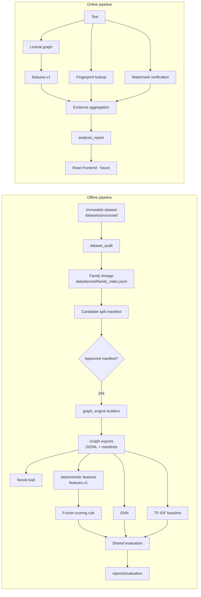

# MVGR-AI

Multi-view graph analysis of human, AI, paraphrased, and deeply paraphrased
text. MVGR-AI turns each document into a graph, extracts deterministic graph
features, and combines them with fingerprint and watermark evidence into a
single, honest evidence report. It never treats the absence of a watermark or
the absence of a model as proof of human authorship.

The dataset is the source of truth. Nothing here invents records, labels, or
paraphrase links, and no artifact may leak labels, source, task, family,
condition, or split into graph structure or model features.

---

## Repository layout

```text
MVGR-AI/
├── README.md
├── requirements.txt
├── .env.example
├── .gitignore
├── pyproject.toml                # additive packaging/CLI entry point
├── mvgr.py                       # additive CLI: audit, split, build, serve, ...
│
├── configs/
│   ├── dataset_config.yaml
│   ├── graph_config.yaml
│   ├── experiment_config.yaml
│   └── evaluation_config.yaml
│
├── data/
│   ├── raw/
│   ├── processed/                # byte-identical contract copy of the source
│   ├── derived/                  # family index, caches
│   └── manifests/                # candidate + approved split manifests
│
├── dataset_audit/
│   ├── inventory.py
│   ├── label_mapping.py
│   ├── lineage.py
│   └── leakage_audit.py
│
├── deterministic/
│   ├── feature_extractor.py
│   ├── clustering.py
│   ├── degree_distribution.py
│   ├── centrality.py
│   ├── graph_density.py
│   ├── shortest_path.py
│   ├── community.py
│   ├── connectivity.py
│   └── scoring.py
│
├── baseline/
│   └── tfidf_logistic.py
│
├── fingerprinting/
│   ├── sha256.py
│   ├── ngram.py
│   └── minhash.py
│
├── watermark/
│   └── verifier.py
│
├── graph_engine/
│   ├── graph_builder/
│   │   ├── lexical_graph.py
│   │   └── syntactic_graph.py
│   ├── neo4j/
│   │   ├── connection.py
│   │   ├── schema.py
│   │   ├── loader.py
│   │   └── queries.py
│   ├── graph_export/
│   │   └── export.py
│   └── gnn/
│       ├── dataset.py
│       ├── model.py
│       ├── train.py
│       └── predict.py
│
├── shared/
│   ├── contracts/
│   │   ├── graph_schema.json
│   │   └── prediction_schema.json
│   ├── preprocessing/
│   └── validation/
│
├── backend/
│   ├── main.py
│   ├── routes/
│   ├── services/
│   └── schemas/
│
├── frontend/                     # placeholder this phase (no UI code yet)
│   └── README.md
│
├── evaluation/
│   ├── metrics.py
│   ├── comparison.py
│   └── error_analysis.py
│
├── experiments/
│   ├── configs/
│   ├── predictions/
│   ├── checkpoints/
│   └── logs/
│
├── reports/
│   ├── dataset_audit/
│   ├── graph_audit/
│   ├── evaluation/
│   └── final/
│
└── tests/
    ├── test_dataset.py
    ├── test_graph.py
    ├── test_deterministic.py
    └── test_integration.py
```

Two artifacts are intentionally outside this tree: `datasets/` (the immutable
upstream download) and `dataset_preparation.py` + `scripts/` (the legacy
generator that produced it). The audit verifies that `data/processed/` is a
byte-identical copy of `datasets/processed/` and fails closed if it is not.

---

## Two pipelines



The offline pipeline is the only path allowed to train or evaluate. The online
pipeline reuses the *same* graph builder, tokenizer, and feature registry as
offline so that a score means the same thing in both.

---

## What is implemented now

* **Contracts** (`shared/contracts`) — JSON Schema plus fail-closed validators
  for graph records, predictions, manifests, the family index, experiments, and
  the analysis report. Content-addressed IDs (`cfg_`, `gb_`, `exp_`, `split_`,
  `man_`, `rep_`).
* **Audit** (`dataset_audit`) — inventory, provenance digest check, label
  mapping, family lineage, leakage and confounding gates. Runs end to end on the
  real 128,709-row corpus.
* **Graph engine** (`graph_engine`) — lexical and syntactic builders, versioned
  JSONL export with build manifests, Neo4j loader/schema/queries, and the GNN
  package (dataset/model/train/predict; PyTorch is an optional extra).
* **Deterministic analysis** (`deterministic`) — 77 `features.v1` features
  across ten independently testable families, plus a validation-selected,
  frozen scoring rule.
* **Baseline** (`baseline/tfidf_logistic.py`) — the required TF-IDF + logistic
  baseline with test-split locking.
* **Fingerprinting & watermark** (`fingerprinting`, `watermark`) — SHA-256,
  n-gram Jaccard, MinHash/LSH reference index, and a watermark verifier that
  defaults to `unsupported`.
* **Backend** (`backend`) — FastAPI app (`/health`, `/v1/analyze`,
  `/v1/contracts/versions`) that always returns a contract-valid report.
* **Tests** (`tests`) — 47 tests covering provenance, lineage, gates, graph
  contracts, features, scoring, fingerprinting, watermark, metrics, the backend
  report, the test lock, and an end-to-end graph→features→score→evaluate run.

Architecture and deliverable documentation lives in
[`reports/final/`](reports/final/README.md).

---

## Quickstart

```powershell
py -3.12 -m venv .venv
.\.venv\Scripts\Activate.ps1
python -m pip install --upgrade pip
pip install -r requirements.txt
pip install -e ".[graph,baseline,dev]"      # networkx + scikit-learn + pytest
```

Run the audit (fails closed until the split manifest is approved):

```powershell
python mvgr.py audit
python mvgr.py lineage
```

Build candidate split manifests:

```powershell
python mvgr.py split-manifest --mode regenerate --scope pooled
python mvgr.py split-manifest --mode existing   --scope pooled
python mvgr.py split-manifest --mode regenerate --scope source_scoped --sources PADBen
```

Build graphs and features, then score:

```powershell
python mvgr.py graph-build --view lexical --split train
python mvgr.py features
python mvgr.py deterministic
```

Serve the online API (requires the `api` extra):

```powershell
python mvgr.py serve
```

Run the tests:

```powershell
python -m pytest
```

---

## Non-negotiable research rules

1. The label is **authorship**, not paraphrase status. A paraphrased AI text is
   still AI-authored.
2. Labels, source, task, family, condition, and split are **never** graph node
   features or model inputs.
3. Train/test leakage is blocked by a family-disjoint split; a manifest is only
   usable after explicit approval (or a recorded `WAIVER:`).
4. Feature selection, direction, and thresholds are chosen on the **validation**
   split only and frozen before the test split is touched. Test access is logged.
5. BiScope has no paraphrase-family identifier in the current build, so pooled
   paraphrase-family claims are unsupported without a waiver.
6. PADBen task semantics are still pending confirmation against the dataset card;
   the audit never infers them from the label distribution.
7. Similarity is evidence of textual overlap, never of common authorship.
8. A missing watermark is not evidence of human authorship.

---

## Dataset sources

* BiScope — <https://huggingface.co/datasets/HanxiGuo/BiScope_Data>
* PADBen — <https://huggingface.co/datasets/JonathanZha/PADBen>

Review each dataset card and license before use or redistribution. Do not
redistribute the merged dataset unless both source licenses permit it.
