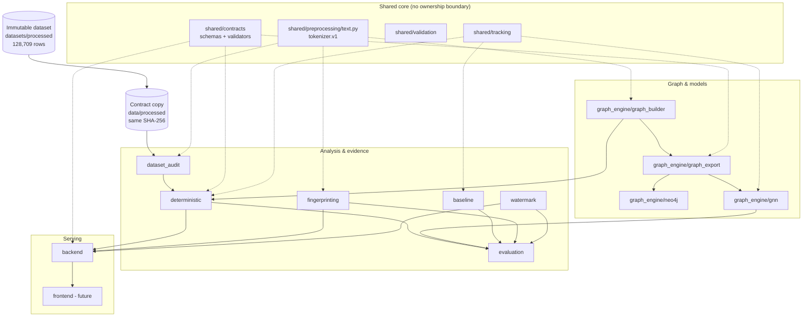

# 1. System architecture

MVGR-AI is a two-pipeline system around one immutable dataset and one set of
contracts. The offline pipeline produces audited artifacts; the online pipeline
answers a single query with an evidence report that reuses the offline graph and
feature definitions.

## Design rules

1. **One dataset, one copy, one digest.** `data/processed/` must be
   byte-identical to `datasets/processed/`. `verify_provenance` raises if they
   diverge, and the audit refuses to run without a verified upstream.
2. **Contracts are the interface.** Every cross-module boundary is a JSON
   Schema with a fail-closed validator. An artifact that does not validate is an
   error, never a warning.
3. **Target metadata is quarantined.** Label, source, task, family, condition,
   and split are never written into a graph record and never used as model
   features. They are joined only inside `evaluation`.
4. **No approval, no training.** The graph/feature/model stages require an
   approved split manifest. Candidates are visible for review but cannot be used.
5. **Honest reporting.** A missing model, index, or watermark is reported as
   unavailable/unsupported and never converted into a positive claim.

## Component map

| Layer | Module | Responsibility |
|---|---|---|
| Contracts | `shared/contracts` | Schemas, validators, content-addressed IDs, versions |
| Preprocessing | `shared/preprocessing/text.py` | The only tokenizer/normalizer (`tokenizer.v1`) |
| Audit | `dataset_audit` | Inventory, provenance, label mapping, lineage, leakage gates |
| Features | `deterministic` | `features.v1` extraction and frozen scoring |
| Baseline | `baseline` | TF-IDF + logistic reference model |
| Fingerprints | `fingerprinting` | SHA-256, n-gram Jaccard, MinHash/LSH index |
| Watermark | `watermark` | Provider-scoped verification; default `unsupported` |
| Graphs | `graph_engine/graph_builder` | Lexical and syntactic graph construction |
| Export | `graph_engine/graph_export` | Versioned JSONL + build manifests |
| Storage | `graph_engine/neo4j` | Connection, schema, idempotent loader, queries |
| Models | `graph_engine/gnn` | Graph datasets, GCN/SAGE/GAT, train/predict |
| Evaluation | `evaluation` | Metrics, comparison, error analysis, test lock |
| Serving | `backend` | FastAPI report assembly and HTTP routes |

## Repository structure

The repository layout is exactly the structure in the root
[`README.md`](../../README.md#repository-layout). Ownership is documented in the
[responsibility matrix](07_responsibility_matrix.md) rather than encoded as
top-level `person1/`/`person2/` folders, so that shared code (`shared/`) has a
neutral home and both contributors work in one tree.
