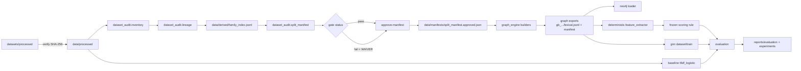
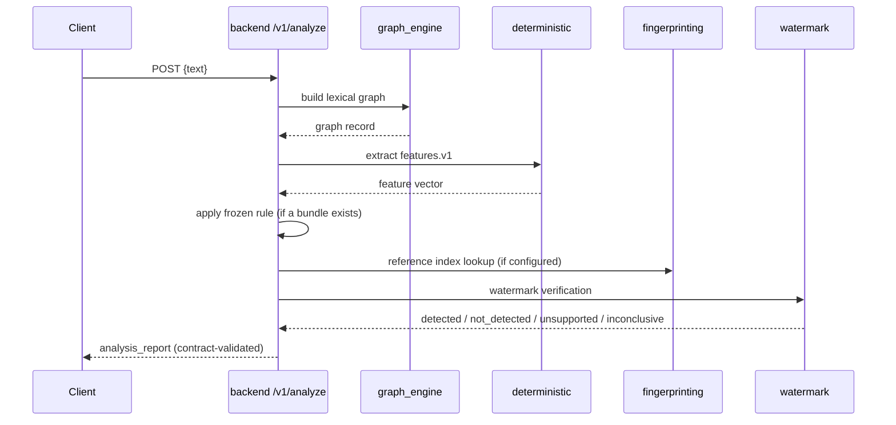
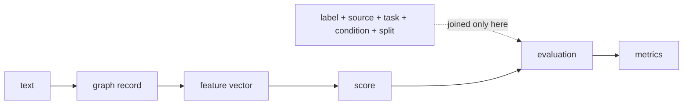

# 2. Offline and online pipelines

## Offline pipeline

The offline pipeline runs once per dataset version and per approved split. It is
the only place where training and evaluation happen.

### Stage order and gates

1. **Provenance** — the contract copy is verified against the upstream digest.
2. **Audit** — inventory, label mapping, lineage, leakage, and confounding.
3. **Family index** — one `family_id` per sample; PADBen is pair-level,
   BiScope is exact-normalized-text only.
4. **Candidate manifest** — family-disjoint assignment with checksummed
   `.ids.txt` sidecars.
5. **Approval** — a failing gate needs a statement beginning with `WAIVER:`.
6. **Graph build** — only from an approved manifest; the export stage rejects
   frames that contain target metadata.
7. **Features** — `features.v1` extraction from the graph export.
8. **Models** — frozen deterministic rule, TF-IDF baseline, and (optional) GNN.
9. **Evaluation** — labels are joined only here, stratified by source/task/
   condition, with bootstrap uncertainty.

## Online pipeline

The online pipeline answers a single text with an evidence report. It reuses the
offline builder and feature registry so a score means the same thing in both
pipelines.

### Degradation policy

| Missing piece | Reported as | Never reported as |
|---|---|---|
| No scoring rule | `classification.status = "unavailable"` | "human" |
| No reference index | `fingerprint.status = "no_reference_index"` | "no reuse found" |
| No watermark provider | `watermark.status = "unsupported"` | "human" |
| Graph dependency error | `graph_analysis.status = "unavailable"` | a fabricated score |

## Data flow: what may cross a boundary

The dashed edge is the only place target metadata may meet a prediction. Graph
records and feature tables are checked to contain no target-metadata columns.
