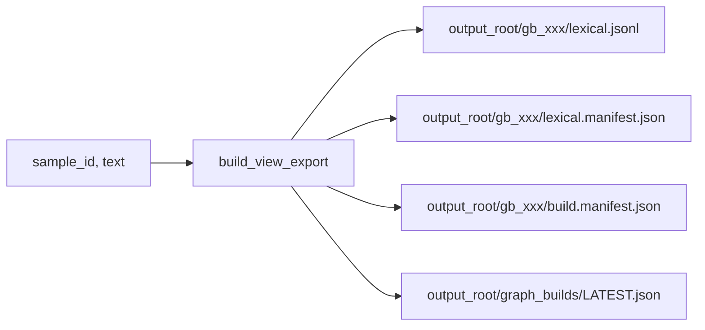
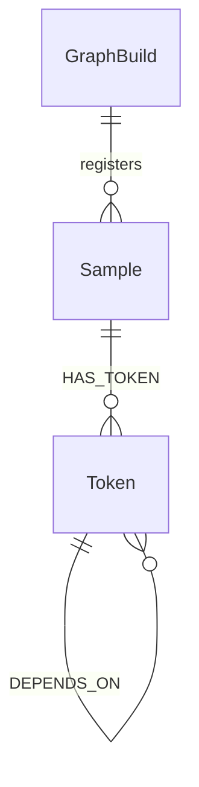

# 3–4. Graph views and Neo4j storage

## Graph views

Two views are defined in `configs/graph_config.yaml`. Both consume only
`sample_id` and `text`; neither writes label, source, task, family, condition,
or split.

### Lexical view (`graph_engine/graph_builder/lexical_graph.py`)

* **Nodes** — one per distinct normalized token in the sample. `node_id` is the
  array index (`0..N-1`), `position` is the first token position, `is_stopword`
  is flagged.
* **Edges** — undirected `cooccurrence` edges inside a sentence-local window
  (`window: 5`). Parallel occurrences are aggregated into one edge with
  `weight = cooccurrence_count`; `distance` is the minimum absolute token
  distance for that pair.
* **Edge cases** — empty text emits an `empty` record with zero nodes/edges;
  a single token yields one node and no edges; all-punctuation text is empty.
* **Truncation** — above `shared.max_nodes`, keep the most frequent tokens (ties
  alphabetical), rebuild edges on the kept set, and set `truncated = true`.

### Syntactic view (`graph_engine/graph_builder/syntactic_graph.py`)

* **Nodes** — token occurrences, excluding punctuation/space/symbol, carrying
  `pos` and `sentence_index`.
* **Edges** — directed `dependency` edges from head to child, with the
  dependency label and token distance; `weight = 1.0`.
* **Parser policy** — a missing spaCy model raises `ParserUnavailable`. The
  builder never falls back to the lexical view. In the reference environment
  (no spaCy) the syntactic build fails loudly, and the test suite skips it.

### View separation rule

A lexical export may contain only `cooccurrence` edges; a syntactic export may
contain only `dependency` edges. `validate_graph_record` enforces this, so a
view can never silently mix edge semantics.

## Export format

`graph_engine/graph_export/export.py` writes one JSONL file per view plus a
per-view manifest and a build-level manifest.

* Each record is validated against `shared/contracts/graph_schema.json` before
  it is written.
* Duplicate `sample_id`s in one export are rejected.
* Per-sample build failures are collected (never swallowed); the build aborts
  after 50 failures and records the first reason.
* The `graph_build_id` (`gb_…`) is content-addressed from dataset version, split
  id, graph spec version, view config, and the sorted sample-id list, so sample
  order cannot change the identity.

## Neo4j storage

### Model

* `(:GraphBuild {build_id, graph_spec_version, dataset_version, split_id,
  config_id, sample_count, created_at})`
* `(:Sample {uid, build_id, sample_id, graph_view, node_count, edge_count,
  empty})` where `uid = build_id:sample_id`
* `(:Token {uid, build_id, sample_id, node_id, token, node_type, position,
  is_stopword})` where `uid = build_id:sample_id:node_id`
* `[:HAS_TOKEN]` Sample→Token
* `[:CO_OCCURS_WITH {weight, distance, build_id}]` Token→Token (lexical)
* `[:DEPENDS_ON {dep, weight, distance, build_id}]` Token→Token (syntactic)

### Isolation and idempotency

The synthetic `uid` is the uniqueness key. This works on Neo4j Community, where
composite uniqueness constraints are unavailable, and it lets two builds
coexist without overwriting each other. `MERGE` on `uid` makes re-running a load
idempotent.

### Schema statements

`graph_engine/neo4j/schema.py` applies the constraints and indexes declared in
`configs/graph_config.yaml`:

* unique constraints on `GraphBuild.build_id`, `Sample.uid`, `Token.uid`
* indexes on `Sample.build_id`, `Sample.sample_id`, `Token.build_id`,
  `Token.token`

### Loader

`GraphLoader.load_export` reads a JSONL export in batches (`batch_size: 500`),
writes each sample with `MERGE`, and produces a `FailureReport`
(`attempted`, `loaded`, `failed`, `failures[]`). When `expected_samples` is
given, a coverage mismatch is appended to the failure report rather than
ignored.

### Queries (`graph_engine/neo4j/queries.py`)

* `build_summary` — counts of samples/tokens/relationships for a build.
* `sample_graph` — nodes and edges of one sample, ordered by `node_id`.
* `missing_samples` — coverage check against an expected id list.
* `list_builds` — all builds with versions and sample counts.
* `delete_build` — deletes exactly one build; `confirm` must equal `build_id`.

## Optional dependency

The Neo4j driver is an optional extra (`pip install -e ".[neo4j]"`). Without a
running database the loader and queries are exercised only through their
interfaces; the export format is fully testable offline.
