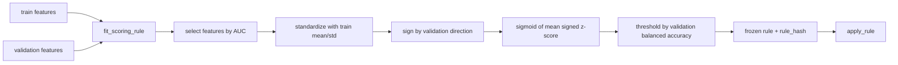

# 5–8. Analysis methods

This document covers the deterministic feature analysis (5), the GNN (6),
fingerprinting (7), and watermark verification (8), plus the required TF-IDF
baseline that the deterministic and GNN models are compared against.

---

## 5. Deterministic analysis (`deterministic/`)

### Feature set `features.v1`

77 features, defined once in `deterministic/feature_spec.py` with a formula and
an `undefined_when` condition each. Undefined values are emitted as `None` in
JSON and `NaN` in Parquet; they are never imputed.

| Family | Count | Module |
|---|---|---|
| size / density / weights | 11 | `graph_density.py` |
| degree distribution | 11 | `degree_distribution.py` |
| clustering | 3 | `clustering.py` |
| centrality | 12 | `centrality.py` |
| components / connectivity | 12 | `connectivity.py` |
| shortest paths | 6 | `shortest_path.py` |
| community structure | 6 | `community.py` |
| view-specific | 16 | `feature_extractor.py` |

The extractor `deterministic/feature_extractor.py` orchestrates the family
modules. It validates every graph record against the graph contract, emits the
`META_COLUMNS` (`sample_id`, `graph_view`, `graph_spec_version`,
`graph_build_id`, `config_id`, `empty`, `feature_set_version`) plus the 77
features in a fixed order, and replaces any non-finite value with `None`.
`assert_registry_complete` fails if the extractor emits a feature that is not in
the registry, or omits one that is.

Computational guards (part of `features.v1`):

* articulation points and bridges — exact only up to 2,000 nodes;
* shortest paths — up to 5,000 nodes;
* Louvain communities — up to 20,000 nodes, seeded with 42.

### Scoring rule (`deterministic/scoring.py`)

1. Feature direction and strength come from the **validation** split only.
2. At most `top_k` features (default 12) with `|AUC − 0.5| ≥ 0.05` are kept.
3. The score is the sigmoid of the mean signed z-score, clipped at ±3.
4. The threshold is chosen on validation by balanced accuracy (ties: higher
   recall).
5. The rule is frozen with a content hash; `load_rule` rejects a tampered rule.

The rule records `selection_split = validation`, `threshold_split =
validation`, and `validation_optimism = true`. The validation estimate is mildly
optimistic; the test split is never used for selection or thresholding.

---

## 6. GNN (`graph_engine/gnn/`)

* **Dataset** (`dataset.py`) — builds PyG `Data` objects from a graph export.
  Node features are label-free: a token-id embedding plus four numeric features
  (`is_stopword`, `is_punctuation`, `position_norm`, `degree_norm`). The token
  vocabulary is fit on the **train split only** and stored with the checkpoint,
  so validation/test tokens are never in the feature space. Empty graphs are
  excluded and reported.
* **Model** (`model.py`) — one view, one model first: GCN, GraphSAGE, or GAT,
  with a token embedding, input projection, `layers` convolutions with LayerNorm
  + ReLU + dropout, and mean pooling to a single logit.
* **Train / predict** (`train.py`, `predict.py`) — early stopping, seeded runs,
  and contract-valid prediction records.

Multi-view fusion is deliberately not implemented until single-view models have
been evaluated on the same `split_id`, `dataset_version`, and seeds.

The GNN requires the optional `gnn` extra (PyTorch + PyG). Without it, the
package imports cleanly and raises `GnnDependencyError` with an install hint
rather than failing obscurely.

---

## 7. Fingerprinting (`fingerprinting/`)

| Method | Module | Meaning |
|---|---|---|
| Exact SHA-256 | `sha256.py` | Byte-identical text |
| Normalized SHA-256 | `shared/preprocessing/text.py` | Same text under NFKC + casefold + whitespace collapse |
| n-gram Jaccard | `ngram.py` | Shingle overlap (default 5-word shingles) |
| MinHash + LSH | `minhash.py` | Estimated Jaccard with banded candidate retrieval |

`ReferenceIndex` (`index.py`) is restricted to an explicit list of reference
sample IDs. A reference index used at inference **must** be built from the
training split only; indexing the test split would turn similarity into a label
leak. The index records its scope in metadata, supports `save`/`load`, and
re-ranks candidates with exact shingle Jaccard when a raw-text lookup is given.

**Interpretation:** every fingerprint result is evidence of textual overlap,
never of common authorship. This is enforced in wording across the report,
evaluation, and docs.

---

## 8. Watermark (`watermark/verifier.py`)

There is no generic AI watermark. Verification is only meaningful for a specific
provider, algorithm, and key/generation protocol.

* Statuses: `detected`, `not_detected`, `unsupported`, `inconclusive`.
* Default provider is `unsupported`, so out of the box the pipeline reports that
  it cannot check, not that the text is human.
* `WatermarkResult.supports_human_authorship` is always `False`.
* The analysis-report validator rejects a report that combines
  `watermark.status = "not_detected"` with `classification.label = "human"`.

---

## Baseline (`baseline/tfidf_logistic.py`)

The required reference model: TF-IDF (word 1–2 grams, `min_df=3`, `max_df=0.95`,
sublinear TF) plus a balanced logistic regression. The vocabulary is fit on the
train split only, and test-split evaluation requires the same `--allow-test`
gate and lock as every other model. Its purpose is to show how much signal comes
from surface lexical cues before any graph method is credited.
