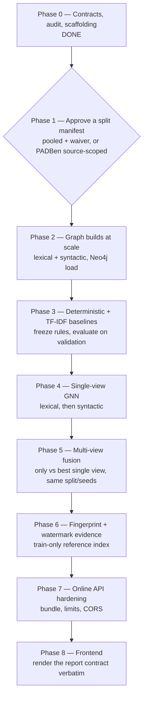

# 16–18. Roadmap, testing strategy and risks

## 16. Roadmap

The roadmap is gated: a phase does not start until its entry condition is met.
The single most important entry condition is an **approved split manifest**.



### Phase 0 — done

Contracts, audit pipeline, family lineage, leakage gates, deterministic feature
registry, frozen scoring, fingerprinting, watermark interface, graph builders,
versioned export, Neo4j loader/schema/queries, backend report assembly, and the
test suite.

### Phase 1 — approve a split manifest (blocked on a human decision)

Three candidates exist. The pooled candidates fail only `lineage_resolution`
because BiScope has no paraphrase-family identifier; the PADBen source-scoped
candidate passes. Approval requires either a PADBen-scoped decision or a
statement beginning with `WAIVER:` for the pooled scope. **This is a research
decision, not an engineering one, and must be made by the contributors.**

### Phase 2–3 — graphs and deterministic baselines

Build both views over the approved split, load Neo4j, extract `features.v1`, fit
and freeze the deterministic rule on validation, and run the TF-IDF baseline.
Both must beat the length-only and majority-class controls before any graph
method is credited.

### Phase 4–5 — GNN

Single-view first (lexical GCN), then syntactic, then fusion only against the
best single-view model on the same split, dataset version, and seeds. The GNN
extra (PyTorch + PyG) is not installed in the reference environment.

### Phase 6–8 — evidence, API, frontend

A train-only reference index for fingerprinting, provider-scoped watermark
verification, API hardening, then the React frontend (placeholder only this
phase).

---

## 17. Testing strategy

The suite is organised by contract boundary and runs without the full corpus or
any optional heavy dependency.

```powershell
python -m pytest        # 47 passed, 1 skipped in the reference environment
```

### Layout

| File | Covers |
|---|---|
| `tests/test_dataset.py` | provenance digest, family lineage, leakage gates, split assignment, manifest schema |
| `tests/test_graph.py` | lexical/syntactic builders, graph contract, build identity, export writer |
| `tests/test_deterministic.py` | feature registry, feature extraction, scoring rule, fingerprinting, watermark, metrics |
| `tests/test_integration.py` | online report contract, backend routes, test lock, graph→features→score→evaluate |

### Principles

1. **Contract-first.** Every artifact is validated against its schema in a test,
   not just at runtime.
2. **Fail-closed is tested.** Provenance mismatch, tampered scoring rules,
   unknown split values, duplicate sample ids, and leaked metadata all have
   explicit "must raise" tests.
3. **Determinism is tested.** Repeated builds must be byte-equal; family
   indexing must be order-independent; build ids must ignore sample order.
4. **No test split.** Tests never read the real test split and never call the
   test lock; the lock itself is tested against a monkeypatched path.
5. **Optional dependencies skip, never fail.** The syntactic builder test skips
   when spaCy is absent; the route test skips when FastAPI is absent. The build
   itself still fails loudly at runtime rather than silently degrading.

### The skipped test

`test_syntactic_view_requires_a_parser_or_fails` skips because spaCy is not
installed. When spaCy is present it validates the syntactic record instead. The
builder's contract is unchanged either way: no parser means `ParserUnavailable`,
never a lexical fallback.

### What is deliberately not tested yet

GNN training, Neo4j against a live database, and end-to-end HTTP are not covered
because their dependencies are optional and no approved manifest exists. Their
interfaces (export format, loader API, report assembly) are covered instead.

---

## 18. Risks and mitigations

| # | Risk | Likelihood | Impact | Mitigation |
|---|---|---|---|---|
| 1 | Paraphrase leakage across splits (BiScope has no family link) | High | High | Family-disjoint split; pooled manifests fail `lineage_resolution` by design; pooled claims require a recorded `WAIVER:` |
| 2 | Condition/label confounding (16 cells, 126,492 rows) | Certain | High | Confounding detected and reported as confounded; per-task strata mandatory; condition-controlled comparisons only |
| 3 | Length confound (human median 222 vs AI 816 chars) | High | Medium | Length-only baseline required; length bins reported |
| 4 | Pooled number hides per-source/per-task behaviour | Medium | High | `always_report` strata; `insufficient_n` below 30 rows |
| 5 | Test-set overfitting | Medium | High | Validation-only selection/thresholding; frozen rule; test lock with logged single use |
| 6 | Target metadata leaks into features | Low | Critical | Schema forbids it; export rejects target metadata; feature table checked in tests |
| 7 | Reference index built from test data | Low | Critical | `build_from: train`, `allow_test_reference: false`; index scope recorded in metadata |
| 8 | Similarity reported as authorship | Medium | High | Wording enforced everywhere; report evidence is `neutral`; docs and tests assert "not authorship" |
| 9 | Missing watermark read as human | Medium | High | Default `unsupported`; `supports_human_authorship` always false; contract rejects not_detected+human |
| 10 | PADBen task semantics guessed wrong | Medium | High | Tasks marked `needs_confirmation`; audit never infers semantics from label distribution |
| 11 | Silent dependency fallback (spaCy → lexical) | Low | High | `ParserUnavailable` raised; no fallback path exists |
| 12 | Irreproducible runs | Medium | Medium | Content-addressed ids, config snapshots, seeds, git state, file-based registry |
| 13 | Dataset edited in place | Low | Critical | Provenance digest check fails closed; upstream `datasets/` treated as immutable |
| 14 | Uncalibrated scores read as probabilities | Medium | Medium | `calibrated: false` in every report; ECE/Brier reported; wording warns |
| 15 | Optional heavy deps (torch/PyG/neo4j/fastapi) absent | High | Low | Import-clean modules raise typed errors with install hints; tests skip cleanly |

### Open decisions (require human input)

1. **Split scope.** Approve PADBen source-scoped, or approve pooled with a
   written `WAIVER:` for the BiScope paraphrase-family limitation.
2. **PADBen task semantics.** Confirm each task's meaning against the dataset
   card before pooled training.
3. **Optional baselines.** Decide whether RoBERTa, GPTZero, or Binoculars are in
   scope, and confirm access/terms before enabling them.
